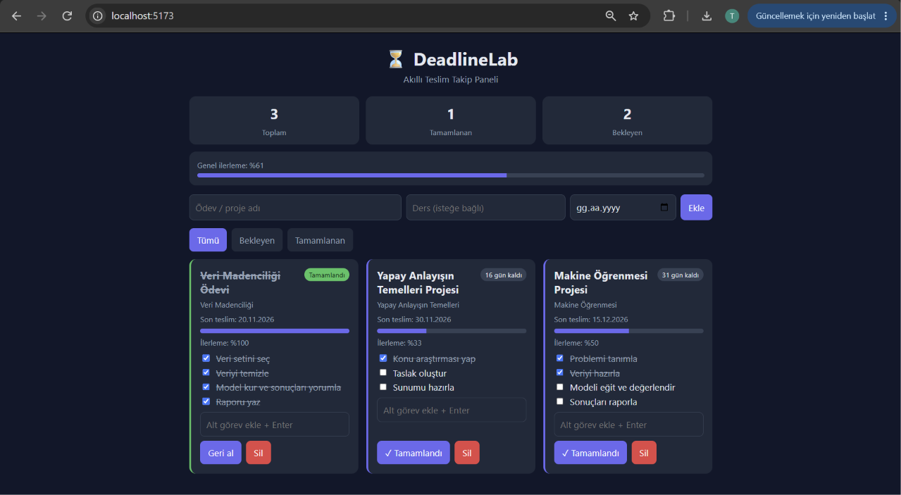

# ⏳ DeadlineLab – Akıllı Teslim Takip Paneli

Öğrencilerin ödev ve projelerini tek ekrandan takip edebildiği bir web uygulaması.



**Canlı demo:** _(Netlify/Vercel linkini buraya ekle)_

## Özellikler
- Ödev/proje ekleme (ad, ders, son teslim tarihi)
- Son teslime kalan süreyi görme (yaklaşan / bugün / gecikmiş renkli rozetler)
- Alt görev ekleme ve tamamlandı olarak işaretleme
- Proje bazında ve genel ilerleme yüzdesi
- Tümü / Bekleyen / Tamamlanan filtresi
- Kayıtlar LocalStorage ile tarayıcıda saklanır

## Kullanılan Teknolojiler
React 18, Vite, saf CSS, LocalStorage

## Kurulum
```bash
npm install
npm run dev      # geliştirme
npm run build    # üretim derlemesi (dist/)
```

## Yapay Zeka Kullanımı
Bu projede **Claude** kullanıldı:
- **Planlama:** Fikir, ekranlar ve veri modeli (`{id, title, course, due, tasks[], done}`) birlikte planlandı.
- **Geliştirme:** React bileşen yapısı, LocalStorage senkronizasyonu, kalan gün / ilerleme hesapları ve CSS taslağı üretildi.
- **Doğrulama:** Üretilen kod tarafımdan çalıştırılıp test edildi, gerekli düzenlemeler yapıldı.
- **Dokümantasyon:** README taslağı yapay zeka ile hazırlandı.

## Dağıtım
Netlify / Vercel: build komutu `npm run build`, yayın klasörü `dist`.
